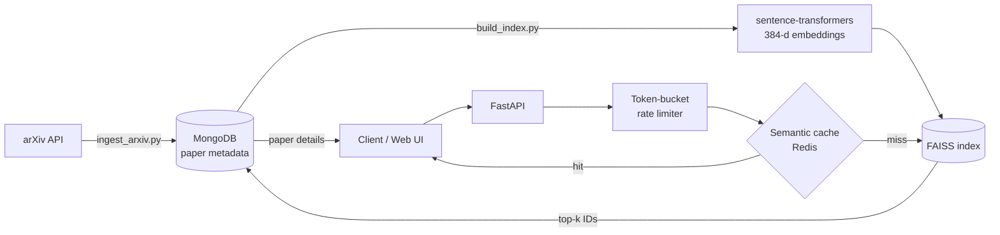

# Semantic Search & Trend Engine for Research Papers

Search arXiv papers by **meaning**, not keywords. Ask *"robot manipulation with language grounding"* and get the papers closest in meaning, even when they never use those exact words. The engine also shows how research topics trend over time.

   

> **Status:** working prototype over 100 VLA / VLM / humanoid-robotics papers.

---

## Architecture



**Request flow for `/search`:** rate-limit check, then embed the query, then check the cache (exact match, then similarity). On a miss, search FAISS for the top-k IDs, fetch the paper details from MongoDB, store the result in the cache, and return it.

## How it works

| Step | Component | What it does | Why this choice |
|---|---|---|---|
| 1 | **Ingestion** (`ingestion/`) | Pulls papers from the arXiv API into MongoDB, deduplicated by arXiv ID | MongoDB also powers the trend aggregations |
| 2 | **Embeddings** (`embeddings/`) | `all-MiniLM-L6-v2` turns each title and abstract into a 384-d vector | Runs locally on CPU, no API cost |
| 3 | **Vector search** (FAISS `IndexFlatIP`) | Finds the top-k papers by cosine similarity | Exact search takes ~1 ms at this size, so approximate indexes (IVF/HNSW) aren't needed yet |
| 4 | **Rate limiter** (`rate_limiter/`) | Token bucket: burst of 20, refills at 10 per minute, returns 429 with `Retry-After` | Built from scratch. One atomic Redis Lua script, so concurrent requests can't spend the same token. Fails open if Redis is down |
| 5 | **Semantic cache** (`cache/`) | Exact-match hash first, then cosine similarity of 0.95 or more against recent query embeddings | Plain string caching misses reworded queries. Trade-off: the similarity lookup is a linear scan |
| 6 | **Trends** (`api/trends.py`) | Paper counts over time, category and keyword breakdowns, growth rate | Answers "what is the field working on?" |

## Results

Measured locally on 10 Aug 2026 against MongoDB Atlas and Redis Cloud (free tiers). Details are in [`benchmark_results/LOAD_TEST_RESULTS.md`](benchmark_results/LOAD_TEST_RESULTS.md).

| Metric | Value |
|---|---|
| FAISS search time (100 vectors) | ~1 ms |
| Cache miss, then cache hit, same query | 1,480 ms, then 353 ms (**76% faster**) |
| Throughput under load (10 to 50 users) | ~1.1 to 1.2 req/s |
| Median `/search` latency, 10 / 20 / 50 users | 3.9 s / 8.1 s / 10 s |
| Rate-limiter tests | 18 passed |

**What these numbers tell us:** FAISS itself is fast. The end-to-end latency comes mostly from embedding the query and from network round trips to the cloud database and cache. Throughput stays flat as users increase, which points to blocking work on the async event loop.

## API

| Method | Endpoint | What it does |
|---|---|---|
| `POST` | `/search` | Semantic search. Body: `{"query": "...", "k": 10}` (k from 1 to 100) |
| `GET` | `/trends` | Paper counts over time (`interval=day\|week\|month`, date filters) |
| `GET` | `/trends/categories` | Paper count per arXiv category |
| `GET` | `/trends/keywords` | Top keywords |
| `GET` | `/trends/growth` | Growth rate for a topic or category |
| `GET` | `/cache/stats` | Cache hits, misses and similarity hits |
| `GET` | `/health`, `/health/live`, `/health/ready` | Health probes |

Interactive docs are at `http://localhost:8000/docs` once the server is running.

```bash
curl -X POST http://localhost:8000/search \
  -H "Content-Type: application/json" \
  -d '{"query": "diffusion policy for robot learning", "k": 5}'
```

## Quick start

**Prerequisites:** Python 3.10 or newer, a MongoDB instance (local or the [Atlas](https://www.mongodb.com/cloud/atlas) free tier) and Redis (local or Redis Cloud). Redis is optional: without it, the rate limiting and caching are switched off.

```bash
git clone https://github.com/Sanika-gupta/Semantic-search.git
cd Semantic-search
pip install -r requirements.txt

cp .env.example .env        # then fill in MONGODB_URI and REDIS_URI
python test_connection.py   # checks MongoDB + arXiv connectivity

python ingest_arxiv.py      # 1. fetch papers into MongoDB
python build_index.py       # 2. embed papers + build the FAISS index
python run_api.py           # 3. API at http://localhost:8000
python run_frontend.py      # 4. (optional) web UI at http://localhost:3000
```

**Load test:**

```bash
locust -f locustfile.py --headless -u 20 -r 5 -t 60s --host http://localhost:8000
```

## Project structure

```
ingestion/      arXiv client + MongoDB client
embeddings/     sentence-transformer wrapper + FAISS vector store
api/            FastAPI app, search service, trend analytics
cache/          Redis wrapper + semantic cache
rate_limiter/   token bucket (Redis + Lua) + FastAPI middleware
frontend/       single-page search UI
tests/          rate limiter and search tests
docs/           design spec and build notes
```

## Limitations (honest list)

- Small corpus: 100 papers.
- No retrieval-quality metrics yet (precision, recall, nDCG).
- Throughput is limited by blocking calls inside async endpoints.
- The cache's similarity lookup is a linear scan.
